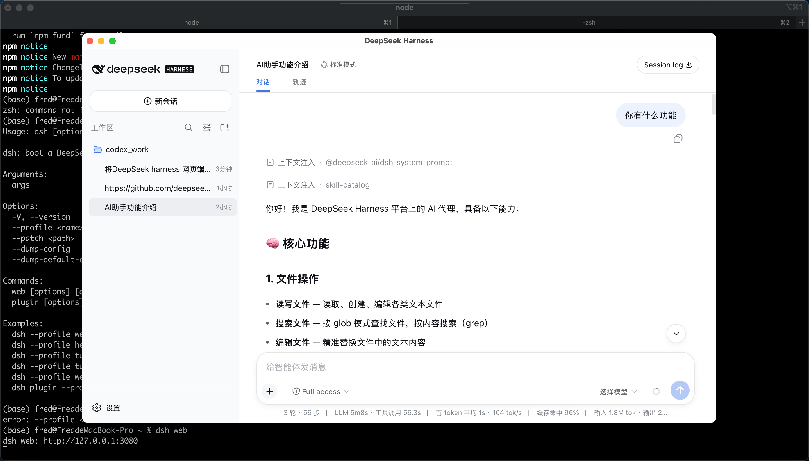
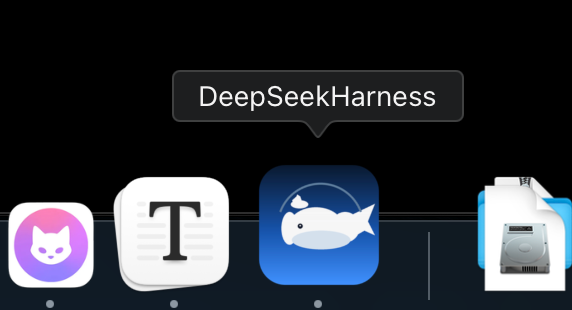

# DeepSeek Harness Desktop

把 DeepSeek Harness 网页端 `dsh web`，http://127.0.0.1:3080 用 [Pake](https://github.com/tw93/Pake)（Rust/Tauri）打包成 Windows / macOS / Linux 三平台桌面 App，并用 GitHub Actions 自动构建、发布到 GitHub Releases，方便任何人直接下载安装包。

<p align="center">
  <a href="https://github.com/ipfred/deepseek-harness-app/releases/latest">
    
  </a>
  <a href="https://github.com/ipfred/deepseek-harness-app/releases/latest">
    
  </a>
  <a href="https://github.com/ipfred/deepseek-harness-app/releases/latest">
    
  </a>
</p>

## 效果图 



## ⚠️ 先理解原理（重要）

这个 App 是"网页外壳"：它把 `http://127.0.0.1:3080` 这个地址包装成原生窗口。
dsh 的网页端不是静态网站（需要 dsh 服务注入启动数据），**所以运行时本机必须先启动 `dsh web`，再打开这个 App**。

- 自己的电脑用：先 `dsh web`，再打开 App（对应下面的"本地打包"）。
- 分发给别人用：别人的电脑也要装 dsh 并启动它 —— 如果希望"装完即用"，见文末【进阶：把 dsh 服务打进安装包】。

**关于认证（auth token）——首次必须做一次**：新版 dsh web 启用了浏览器认证，直接访问
`http://127.0.0.1:3080/` 会返回 401。首次打开 App 时，把 `dsh web` 启动时**终端打印的那条
链接**（形如 `dsh web: http://127.0.0.1:3080/?token=…`）粘贴进 App 弹出的认证界面即可。
token 是每个 dsh web 进程随机生成的、重启就换，**没法预先写进安装包**；但用它换取一次
cookie 后本机会记住 **30 天**，期间打开 App 无需再次输入。详见【常见问题】。

## 安装 DeepSeek Harness 本体（`dsh`）

桌面壳只是"窗户"，先装好"服务" dsh 本体才看得见风景。

- **原仓库**：[deepseek-ai/deepseek-harness](https://github.com/deepseek-ai/deepseek-harness)（DeepSeek Harness 官方仓库，迭代很快的 developer preview）
- 安装方式（任选其一，需要 Node.js）：

```bash
# 方式一：不安装，直接跑（官方推荐；npx 会自动拉取最新版）
npx @deepseek-ai/dsh web

# 方式二：全局安装后运行（适合经常用）
npm install -g @deepseek-ai/dsh        # 或 pnpm add -g @deepseek-ai/dsh
dsh web

# 方式三：从源码跑
git clone https://github.com/deepseek-ai/deepseek-harness.git
cd deepseek-harness && pnpm install && pnpm run build
pnpm dsh web
```

启动后服务地址：http://127.0.0.1:3080（默认）。终端会打印一条带 token 的链接
（`dsh web: http://127.0.0.1:3080/?token=…`）并自动用默认浏览器打开它，再打开桌面 App 即可。

> ⚠️ `curl http://127.0.0.1:3080/` 现在返回 **401** 属于正常 —— 说明服务起来了、且认证已启用，
> 不是"服务没启动"。要确认服务可用，看 HTTP 状态码是不是 200/303/401 即可。

升级/反馈/插件生态请看原仓库的
[GitHub Discussions](https://github.com/deepseek-ai/deepseek-harness/discussions)。

## 目录结构

```
deepseek-harness-app/
├── .github/workflows/build.yml   # 三平台矩阵打包 + 自动上传 GitHub Release
├── assets/icon.png               # 应用图标（1024x1024，可替换）
├── scripts/
│   ├── build-locally.sh          # 本地一键打包
│   ├── external-links.js         # 注入脚本：外部链接一律用系统默认浏览器打开（防窗口被覆盖）
│   ├── check-update.js           # 注入脚本：检测桌面壳新版本，提示用系统浏览器去下载
│   ├── auth-token.js             # 注入脚本：401 时引导粘贴 dsh web 的带 token 链接，换取 30 天免认证
│   ├── patch-pake-capability.js  # 构建前置：放行 http 本地服务调用 shell.open（修 Tauri v2 scope）
│   └── make-icon.py              # 图标生成脚本（可选）
├── .gitignore
└── README.md
```

设计取舍：仓库只存"编排 + 图标"，不提交任何构建中间产物
（`src-tauri/`、`node_modules`、安装包等全被 .gitignore 掉）。
每次 CI 在 runner 上用固定版本的 pake-cli 现场生成并打包，保证可复现、零仓库体积。

## 一、本地打包（对应你手动的 1~4 步）

```bash
# 1. 安装 Pake（npm/pnpm 均可）
pnpm install -g pake-cli

# 2. 启动 dsh web
dsh web

# 3. 一键打包（内含启动检查，也可直接手动跑 pake 命令）
./scripts/build-locally.sh 0.1.0

# 4. 安装：产物在当前目录
#    macOS  双击 DeepSeekHarness_*.dmg
#    Windows 双击 DeepSeekHarness_x64.msi（AMD/Intel）或 DeepSeekHarness_arm64.msi（骁龙等 ARM）
#    Linux  sudo dpkg -i deepseek-harness_*.deb  或 运行 *.AppImage
```

手动等价命令：

```bash
pake http://127.0.0.1:3080/ --name DeepSeekHarness --title "DeepSeek Harness" \
     --identifier com.deepseekharness.app --icon assets/icon.png \
     --width 1280 --height 800 --app-version 0.1.0 \
     --inject scripts/external-links.js,scripts/check-update.js,scripts/auth-token.js
```

## 二、GitHub Actions 自动打包 + 发布 （核心）

### 使用流程（给别人下载）

1. 把这个目录推成一个 GitHub 仓库：`git init && git add . && git commit -m init && git push`
2. 打 tag 触发自动构建 + 发布：

   ```bash
   git tag v1.0.0
   git push origin v1.0.0
   ```

3. 等约 10~25 分钟（首次编译较久，后续有缓存会快很多）。
   构建完成自动出现在仓库 **Releases** 页面，三平台安装包直接可下载：
   - `DeepSeekHarness.dmg`（macOS，**universal 双架构**：Intel + Apple Silicon 一份通吃）
   - `DeepSeekHarness_x64.msi` / `DeepSeekHarness_arm64.msi`（Windows x64 与 ARM64 原生）
   - `deepseek-harness_*.deb` + `.AppImage`（Linux）

不想打 tag 时：到 Actions 页 → **Build & Release** → **Run workflow** 手动触发，
产物可在运行记录页的 artifacts 里下载（并可用 `prerelease` 输入标记为预发布）。

### 触发方式

| 触发 | 效果 |
|---|---|
| `git push origin v*` | 自动构建 + 上传到 GitHub Release **草稿**（版本号取 tag，去掉 `v`）；你在 Releases 页确认后手动点 Publish 上线 |
| 手动 Run workflow | 只构建 + 上传 artifacts，不创建 Release（除非打了 tag） |

### 工作流设计要点

- **三平台矩阵**：`macos-latest` / `windows-latest` / `ubuntu-24.04`，`fail-fast: false`
  一个平台失败不影响其他平台。
- **不依赖目标 URL 可达**：图标、标题都用参数显式传入，pake 抓取 favicon
  失败只会降级为默认值，不会让构建失败 —— CI 机器上 `127.0.0.1:3080` 不存在也没关系。
- **Rust 编译缓存**：`swatinem/rust-cache`，同一 pake 版本依赖一致，
  二次构建从 ~20 分钟降到 2~3 分钟。
- **版本号解析**：input 的 `app_version` 优先 → 否则取 tag `v1.0.0` → 默认 `0.1.0`。
- **pake 版本钉死**：`PAKE_VERSION: 3.15.6`，发版可复现；升级只需改这一个变量。
- **Linux 包名**：pake 会自动把 `DeepSeekHarness` 转成合法的 `deepseek-harness`，无需处理。
- **release 发布**：`softprops/action-gh-release`，仅 tag 触发时执行，支持覆盖更新。

### 平台与架构覆盖

| 平台 | 架构 | 说明 |
|---|---|---|
| macOS | **x86_64 + arm64（universal）** | `--multi-arch` 一份 dmg 同时支持 Intel 与 Apple Silicon 芯片（已用 lipo 实测验证) |
| Windows | **x86_64 + aarch64** | `x64.msi` 全 Windows 可用；`arm64.msi` 为骁龙/ARM 版 Windows 原生包（尽力而为构建） |
| Linux | x86_64（deb / AppImage） | 另有 `deb-arm64` 等目标可选（见 Pake 文档），跨架构编译需 arm64 依赖，留作后续 |

注：命令行本地打包时，Windows 用 `--targets x64` 或 `--targets arm64` 控制架构；macOS 默认打本机架构，加 `--multi-arch` 打 universal。

### 可调参数

| input | 默认值 | 说明 |
|---|---|---|
| `url` | `http://127.0.0.1:3080/` | 打包的地址 |
| `app_version` | 空（取 tag） | 版本号 |
| `linux_targets` | `deb,appimage` | Linux 包格式，可加 `rpm` |
| `multi_arch` | `true` | macOS 是否打 universal（同时支持 Intel/Apple Silicon） |
| `prerelease` | `false` | 是否发布为预发布版 |

| env | 默认值 | 说明 |
|---|---|---|
| `APP_NAME` / `APP_TITLE` | `DeepSeekHarness` | 应用名 / 窗口标题 |
| `APP_IDENTIFIER` | `com.deepseekharness.app` | Bundle ID |
| `PAKE_VERSION` | `3.15.6` | pake-cli 版本（钉死可复现） |

## 三、代码签名（可选，但强烈建议分发时做）

不签名直接分发的后果：

- **macOS**：用户双击会提示"无法打开，因为 Apple 无法检查其是否包含恶意软件"。
  临时解决：右键 → 打开 → 再点打开；或 `xattr -cr /Applications/DeepSeekHarness.app`。
  正式解决：Developer ID 签名 + 公证。
- **Windows**：SmartScreen 蓝屏警告"Windows 已保护你的电脑"。正式解决：EV 证书 / Azure Trusted Signing。
- **Linux**：无强制要求。

工作流已内置 **macOS 签名 + 公证** 的步骤（检测到 secrets 才启用）。
在仓库 Settings → Secrets and variables → Actions 里配置：

| Secret | 用途 |
|---|---|
| `MACOS_CERT_P12` | 签名证书（base64 编码的 .p12） |
| `MACOS_CERT_PASSWORD` | 证书密码 |
| `MACOS_SIGNING_IDENTITY` | 可选，如 `Developer ID Application: xxx (TEAMID)`，缺省自动识别 |
| `MACOS_NOTARIZE_APPLE_ID` | 公证用 Apple ID |
| `MACOS_NOTARIZE_TEAM_ID` | 公证用 Team ID |
| `MACOS_NOTARIZE_PASSWORD` | Apple ID 专用密码（App-specific password） |

Windows 签名可在此基础上加一个 `signtool` 步骤（需要证书），README 不展开。

## 四、常见问题

<details>
<summary><b>页面上点链接，能不能默认用系统浏览器打开？为什么有时把 App 窗口整个覆盖掉 / 点了没反应？</b></summary>

**可以，且本仓库已配好。** 规则：只有与 App 主入口同源（`http://127.0.0.1:3080` 及其路由）的地址留在 App 窗口内；其它任何本地端口（如 `http://127.0.0.1:5173`、`localhost:xxxx`）与外网地址一视同仁，一律交给系统默认浏览器。

实现上有两层，缺一不可：

1. **注入拦截脚本** `--inject scripts/external-links.js`：在 `<a>` 点击、`window.open`、`location.assign/replace` 三处拦截，不同源的 http(s) 地址改走 `plugin:shell|open`。
2. **放行 capability**（`scripts/patch-pake-capability.js`，构建前自动执行，幂等）：
   把 pake 模板 `capabilities/default.json` 的 `remote.urls` 加上 `http://*:*`。

   **为什么必须这一步？** Tauri v2 的 `shell:allow-open` 自带 URL scope，默认只允许
   `[URL: local]` 和 `[URL: https://*.*]` 的页面调用 `shell.open`。而我们的 App 页面是
   `http://127.0.0.1:3080`（http 明文本地服务），不在 scope 内，`shell.open` 会被直接拒绝
   —— 不光本仓库的注入脚本打不开外链，**连 pake 内置的外链拦截也会失效**。所以任何
   用 Pake 打包 http 本地服务的场景都需要这个 patch。

**验证方法**：点一个 `http://127.0.0.1:5173` 或外网链接，应在系统默认浏览器新开标签页，
App 窗口保持不动。

**已知边界**：页面代码里 `window.location.href = 外链` 这种赋值无法在网页侧拦截
（`Location.prototype.href` 不可重定义）。若未来 dsh 出现这类直跳，彻底方案是自建
`src-tauri` 在 Rust `on_navigation` 层做白名单拦截（见【进阶】）。
</details>

<details>
<summary><b>macOS 打包时 DMG 失败（bundle_dmg.sh 报错）？</b></summary>

工作流的 macOS 步骤已设置 `TAURI_BUNDLER_DMG_IGNORE_CI: "true"` 规避 create-dmg 的 CI
检测问题；本地构建脚本也默认带上。若仍失败，可去掉 `--multi-arch` 再试，
或改用 `--iterative-build` 只产出 `.app`（可运行，只是不是安装包）。
</details>

<details>
<summary><b>我电脑上正用着 dsh web（比如正开着这个网页），装桌面版会不会冲突/被替换？</b></summary>

不会。桌面壳只是把 `http://127.0.0.1:3080` 包成一个原生窗口：安装只是把一个
`.app` / `.exe` 复制进系统应用目录，**不会停止、替换或修改正在运行的 dsh 服务**；
两者可同时存在（甚至能同时开多个窗口），卸载壳应用也不影响 dsh 本体。
</details>

<details>
<summary><b>打开 App 显示空白 / 连不上？</b></summary>

确认 `dsh web` 已在运行（`curl -s -o /dev/null -w '%{http_code}' http://127.0.0.1:3080/`
返回 **200/303/401** 都算正常，401 只表示还没认证）。
壳应用本身不启动服务（想开箱即用请看【进阶】）。

如果界面停留在"需要认证"，见下面那条 FAQ。
</details>

<details>
<summary><b>App 提示"需要认证" / 要我在终端里找 token？</b></summary>

新版 dsh web 给浏览器界面加了认证（防止其它进程/网页直连本机 `127.0.0.1:3080` 的 API）：

1. **不需要改安装包，也不需要重新打包。** token 是每个 `dsh web` 进程启动时**随机生成**的，
   只存在于进程内存和启动打印的链接里，重启就换 —— 所以不可能预先写死进 App 的首页 URL。
   App 的首页地址仍然是 `http://127.0.0.1:3080/`，只是在 401 时多了一个认证引导层。

2. **首次打开 App**（或 cookie 失效后）窗口会显示认证界面。把 `dsh web` 启动时终端打印的
   那行整条复制粘贴进去即可（只粘 token 部分也行）：

   ```
   dsh web: http://127.0.0.1:3080/?token=2wlGc88MorRNmSKBB0OdlLmjTTCrqQzoPzDxEBQ64WY
   ```

   点「认证并进入」→ App 访问 `/?token=…` → 服务端种 cookie 并重定向回干净 `/`。

   > 注意：**别从浏览器地址栏复制**。dsh 自动打开浏览器后，地址栏已被重定向成干净的
   > `/`，token 已经不在里面了；复制上面那行**终端输出**才有效。

3. **之后 30 天不用再输。** 认证成功会种下绑定 `127.0.0.1:3080` 的签名 cookie
   （`Max-Age=2592000` 秒，密钥持久化在 `~/.dsh/.credentials.yaml`），App 之后直接进入。
   下列情况才会重新要求认证：
   - cookie 超过 30 天，或 App 的 webview cookie/数据被清除；
   - 删掉或替换了 `~/.dsh/.credentials.yaml` 中 `client-connection/browser-session` 记录；
   - 换了端口（cookie 绑定 `host:port`，而壳默认固定 `127.0.0.1:3080`）。

4. **排错**：
   - 粘贴后仍回到认证界面、并提示"token 无效或已过期" → 多半是复制了**旧进程**的链接
     或粘贴时被截断；改用当前正在运行的 dsh web 最新打印的那行重试。
   - 必须用 `127.0.0.1:3080` 打开（与 token / cookie 的 authority 一致）。
     用 `localhost:3080` 会因为 authority 不同而无法复用已有 cookie。

实现见 `scripts/auth-token.js`（构建时经 `--inject` 注入）；它只做两件事：发现 401 页面就
显示粘贴框，把解析出的 token 拼到 `/?token=` 上跳转，其余情况完全不干预页面。
</details>

<details>
<summary><b>Linux 双击 .AppImage 没反应？</b></summary>

AppImage 需要 FUSE：`chmod +x xxx.AppImage && ./xxx.AppImage`；
虚拟机/容器里常见，可加 `--appimage-extract-and-run`。deb 包需要 webkit2gtk 运行时，
发行版不同依赖略有差异。
</details>

<details>
<summary><b>怎么换图标？</b></summary>

替换 `assets/icon.png`（1024x1024 PNG）即可，或者手动改命令里的 `--icon`。
</details>

<details>
<summary><b>新版本 dsh 怎么出包？</b></summary>

`git tag v1.1.0 && git push origin v1.1.0`，CI 会自动构建并把安装包上传到 GitHub Release
**草稿箱**；你到 Releases 页确认无误后手动点 "Publish release" 上线。升级 pake 就改
`PAKE_VERSION` 后重打一个 tag。
</details>

<details>
<summary><b>桌面壳有"检查更新"吗？怎么通知用户？</b></summary>

有（方案 A：提示 + 手动下载）。打包时通过 `--inject scripts/check-update.js` 注入了一段轻量
脚本，行为：

- App 启动时静默调用 GitHub Releases API（`releases/latest`）拉最新已发布 tag，与本地
  localStorage 记的"已知晓 tag"比对。**有更新的 tag** 才在右上角弹一个小卡片：
  `桌面壳有新版本 vX.Y.Z  [前往下载] [×]`。
- 点 `[前往下载]` → 用系统默认浏览器打开该 Release 页面（复用外链拦截的 `plugin:shell|open`），
  你手动下载新安装包覆盖安装即可；同时该 tag 记为"已知晓"、卡片关闭。
- 点 `[×]` 同样记为已知晓、暂不提醒，直到下一次出现更新的 tag。
- 无新版 / 网络失败 / 被 CSP 拦截 → **静默，完全不打扰**。每 6 小时在同一会话内复查一次。
- 首次运行以当前 latest 为基线、不弹提示。

注意：GitHub API 的 `releases/latest` **只返回已正式 Publish 的 Release**，草稿不算。
所以 CI 改成"先存草稿、手动 publish"后，只有你 publish 出去的版本才会被桌面壳检测到。

> dsh 服务本体的升级不走这条线：直接 `npm i -g @deepseek-ai/dsh@latest`（或 `npx` 每次拉最新）
> 即可，**不用换安装包**。本机制只针对"Pake 壳本身"出新版（如改了图标 / 窗口 / 注入脚本等）。
</details>

## 五、进阶：把 dsh 服务打进安装包（开箱即用）

如果希望别人**装了就能用**（不用自己装 dsh/启动服务），需要把 dsh 命令行程序作为
Tauri **sidecar** 打进应用，App 启动时自动拉起服务、等端口就绪后加载页面：

1. 用 pake 生成后，在 `src-tauri/tauri.conf.json` 配置外部二进制：
   ```json
   "bundle": {
     "externalBin": ["binaries/dsh-server"]
   }
   ```
   （构建时对应平台命名为 `dsh-server-<target-triple>`，随包分发 dsh 及其 web 资源。）
2. 在 `src-tauri/src/main.rs`（或 lib.rs）里启动 sidecar：
   ```rust
   let (mut rx, _child) = app.shell().sidecar("dsh-server")?.spawn()?;
   // 轮询 http://127.0.0.1:3080/ 直到 200，再让 Webview 加载该地址
   ```
3. App 退出时（`on_window_event` 的 CloseRequested）杀掉子进程。

代价：产物体积变大（dsh 运行时 + web 资源）、macOS 上 sidecar 同样要签名/公证。
这也是 Pake 官方 [tw93/Pake](https://github.com/tw93/Pake) 社区仓库对"本地服务型网页"
类应用的主流做法。仓库结构可对应升级为：

```
src-tauri/            # 提交自定义的 Tauri 工程（含 sidecar 逻辑）
  src/main.rs
  tauri.conf.json
  binaries/           # 或 CI 里下载 dsh 后按平台重命名
scripts/fetch-dsh.sh  # CI 步骤：下载对应平台 dsh 二进制
```

## 推荐插件 / 资源

DeepSeek Harness 有活跃的插件生态，以下是一些不错的资源（持续更新）：

| 名称 | 地址 | 说明 |
|---|---|---|
| 插件市场 | https://awesome-dsh-plugin.com/ | DSH 插件聚合市场，浏览 / 搜索社区插件 |
| dsh-web-ui | https://github.com/zhu1090093659/dsh-web-ui | DSH Web UI 插件全家桶（SSH / 任务看板 / 右侧面板等） |

> 发现新的好插件会陆续补充到此表。

## License

MIT（本项目仅为 Pake 打包编排模板；dsh 本体版权归其作者所有）。

---

## Friendship Link

Thanks for the support and feedback from the friends at [LINUX DO](https://linux.do/). 